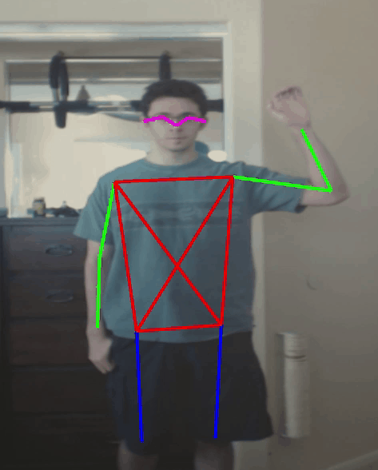

# Barracuda Pose Estimation Project Log Pt. 4

> [!NOTE]
> **Retired from [christianjmills.com](https://christianjmills.com) on 2026-10-09.** This post was first published on 2020-09-24 at <https://christianjmills.com/posts/barracuda-pose-estimation-project-log/part-4/>, which now redirects here. It is kept as it was written; its tools and steps may be out of date.
>
> Source: [`posts/barracuda-pose-estimation-project-log/part-4/index.md@8229e99`](https://github.com/cj-mills/christianjmills/blob/8229e991c0be7f8c78a909f0d8a2ca74390dc1e6/posts/barracuda-pose-estimation-project-log/part-4/index.md)

*I’m an idiot.*

### Update 7/31/2021: [Barracuda PoseNet Tutorial 2nd Edition](https://github.com/cj-mills/Barracuda-PoseNet-Tutorial/blob/main/retired-post/barracuda-posenet-tutorial-v2/part-1/README.md)

## I Fixed the Offset Vectors…

Well I feel like an idiot. It turns out I’ve had the x and y offset vectors swapped this whole time. That explains why the gap problem with the heatmaps seemed so much worse when using lower resolutions. The offsets had to be bigger but they were going in the wrong directions.

I finally stumbled across my mistake by pausing the project and clicking through frame by frame to see if the corresponding x and y values made sense. I can’t believe I didn’t check the values for those sooner. I’m guessing that I was just glad it was working at all at the time and moved on to other things. Well, lesson learned I guess.

On the bright side, the pose skeleton looks way better now! Comparing the pose skeletons with and without the offsets swapped makes it really apparent in hind sight. Also, this completely resolved the issues with the MobileNet models mentioned in the previous post. Their performance is still noticeably worse than the ResNet model but that’s expected.

Annoyingly, now that I’ve finally fixed this issue the post processing bottleneck is all the more noticeable. The MobileNet model is much more efficient but the current bottleneck means there isn’t much difference in framerate.

### Before:

[▶ Video: pose_estimation_swapped_offsets](./videos/pose_estimation_swapped_offsets.mp4)

### After:

